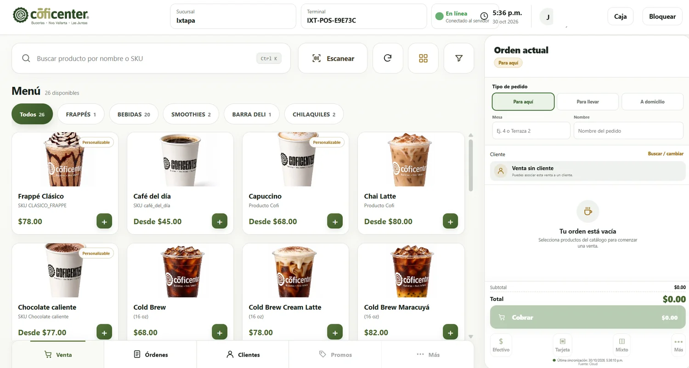
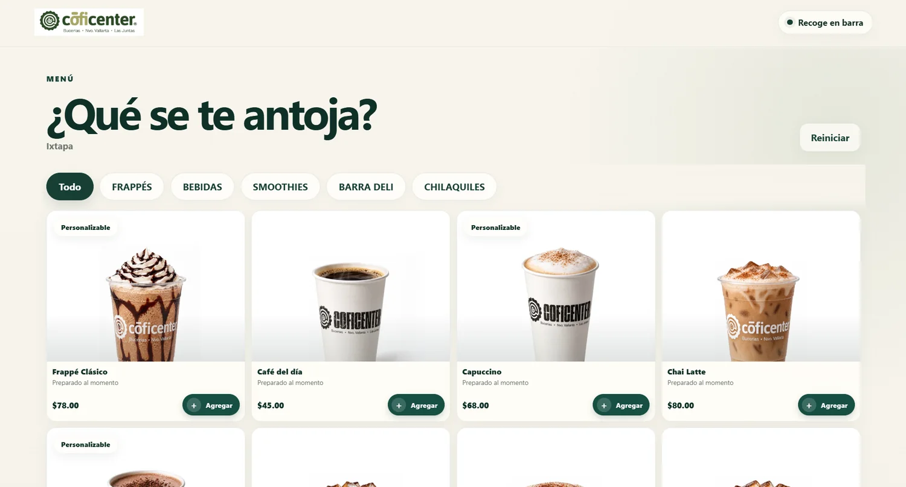
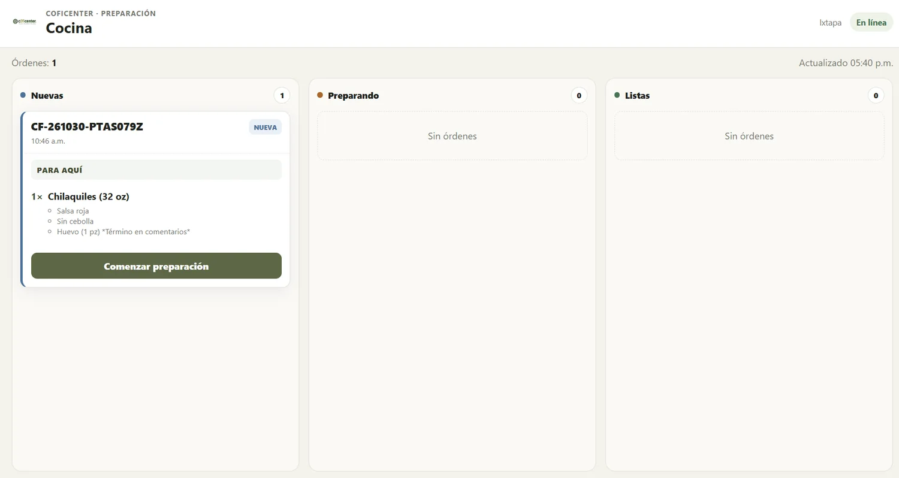
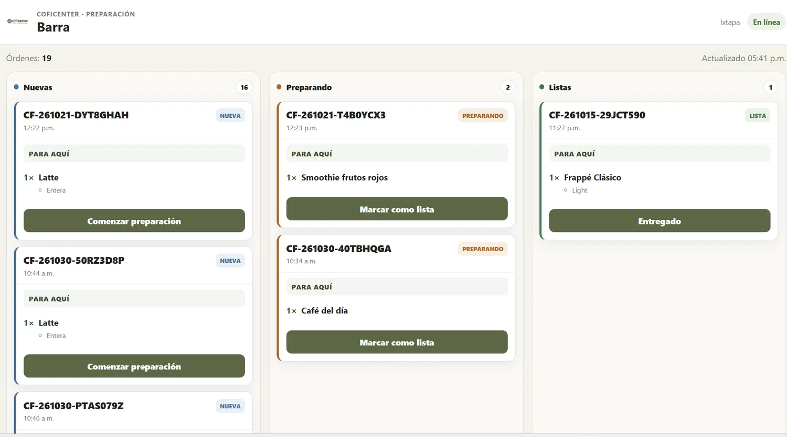
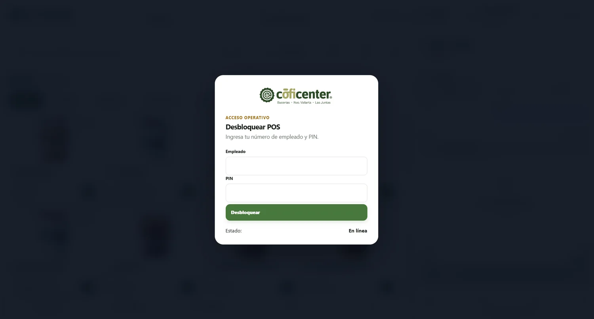
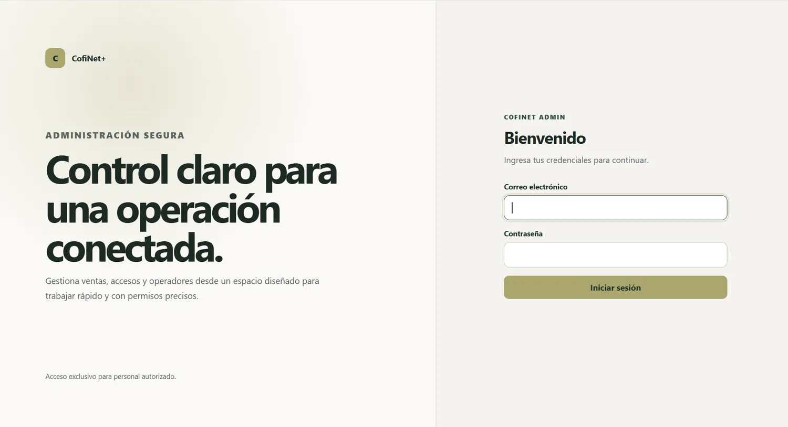
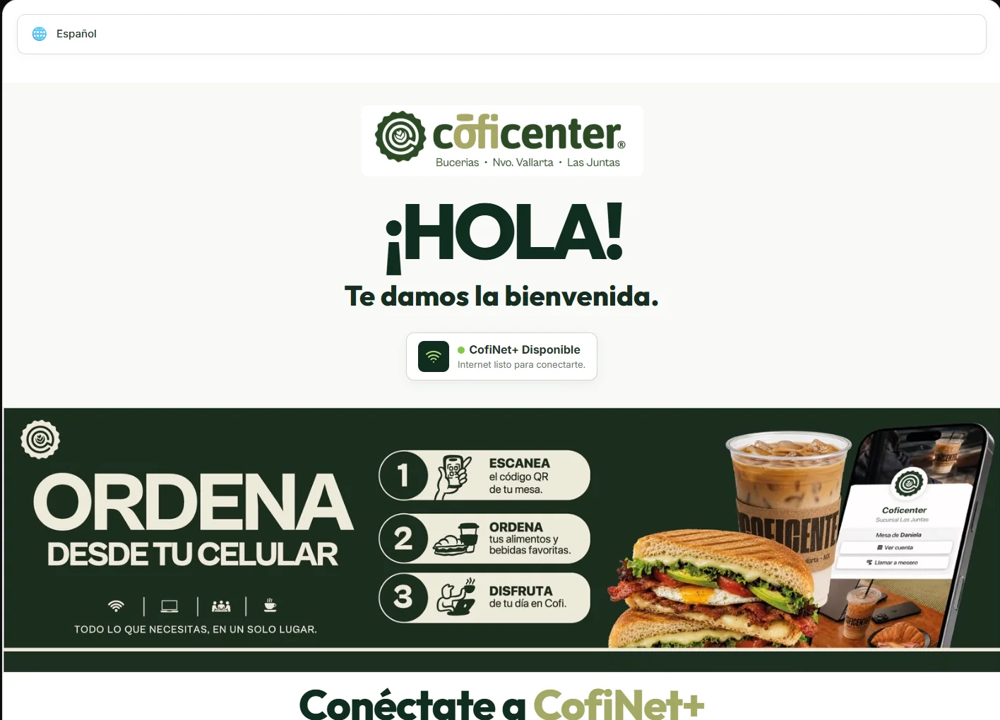
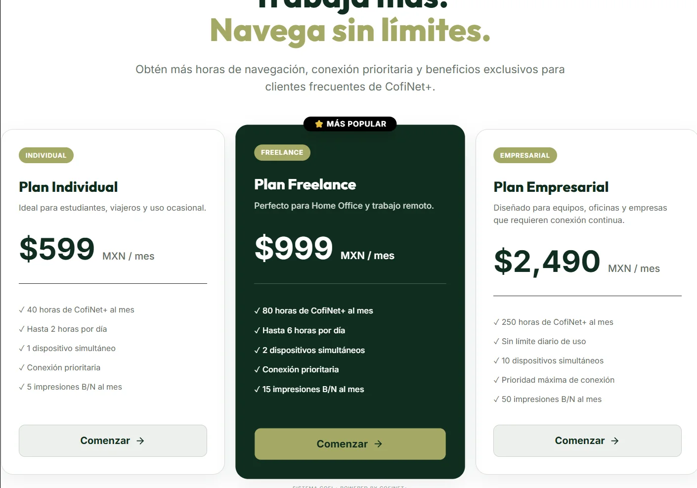
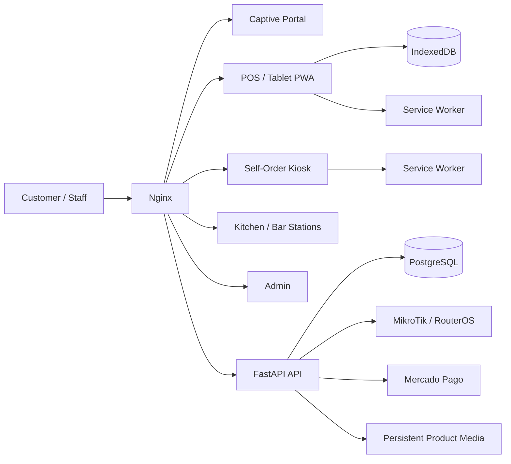

# CofiNet+ — Wi-Fi, POS & Hospitality Operations Platform

> A production-deployed platform that combines captive Wi-Fi access, point of sale, self-service ordering, kitchen/bar operations, staff controls, receipts, and multi-branch administration in one system.

CofiNet+ started as a captive portal for managed Wi-Fi and evolved into a broader hospitality operations platform. The project now includes a touch-first POS, customer self-order kiosk, kitchen and bar station screens, branch-aware catalog management, staff authentication, cash-shift workflows, audit logging, fiscal receipt support, product variants, and media-enabled modifier options.

This repository is presented as an **engineering portfolio project**. Production secrets, private keys, database dumps, certificate material, and live credentials are intentionally excluded.

## My Role

I designed, developed, integrated, and deployed CofiNet+ end to end, taking it from an initial captive Wi-Fi portal into a broader hospitality operations platform.

My contribution includes:

- Designing the overall application and deployment architecture
- Building and evolving the **FastAPI + PostgreSQL** backend
- Developing the touch-first **POS**, customer self-order experience, and kitchen/bar station interfaces
- Modeling operational domains such as staff access, cash shifts, receipts, audit events, product variants, and modifiers
- Implementing **multi-branch** behavior and branch-specific configuration
- Integrating **MikroTik / RouterOS** connectivity and payment-related workflows
- Building PWA/offline capabilities with **Service Workers and IndexedDB**
- Managing database evolution through **Alembic migrations**
- Containerizing and deploying the system with **Docker Compose and Nginx**
- Creating automated tests, release checks, backup procedures, and rollback safeguards
- Maintaining and iterating on a live production deployment

The project reflects both product development and operational ownership: translating real business workflows into software, deploying them safely, and continuing to improve the system without interrupting day-to-day use.

## Highlights

- **Captive Wi-Fi portal** with MikroTik / RouterOS integration
- **Touch-first POS** for counter and tablet workflows
- **Customer self-order kiosk / PWA**
- **Kitchen and bar KDS-style station views**
- **Multi-branch catalog and branch-aware behavior**
- **Product variants and modifier groups**
- **Product and modifier-option images**
- **Staff authentication and POS session controls**
- **Cash shifts and cash movement tracking**
- **Order lifecycle and station progress**
- **Receipt snapshots, printing, fiscal information, QR billing support**
- **Audit trail for operational events**
- **Offline-oriented POS architecture using IndexedDB + Service Worker**
- **FastAPI + PostgreSQL backend**
- **Docker Compose + Nginx deployment**
- **Alembic database migrations**
- **Automated backend and frontend tests**

## Product Preview

<table>
  <tr>
    <td width="50%">
      <strong>Touch-first POS</strong><br>
      
    </td>
    <td width="50%">
      <strong>Customer self-order</strong><br>
      
    </td>
  </tr>
  <tr>
    <td width="50%">
      <strong>Kitchen station</strong><br>
      
    </td>
    <td width="50%">
      <strong>Bar station</strong><br>
      
    </td>
  </tr>
  <tr>
    <td width="50%">
      <strong>POS staff access</strong><br>
      
    </td>
    <td width="50%">
      <strong>Secure administration</strong><br>
      
    </td>
  </tr>
  <tr>
    <td width="50%">
      <strong>Captive Wi-Fi portal</strong><br>
      
    </td>
    <td width="50%">
      <strong>Access plans</strong><br>
      
    </td>
  </tr>
</table>

The screenshots above are sanitized portfolio captures. Production credentials and sensitive operational data are not included.

## System Architecture



Nginx is the public entry point. Static interfaces are served directly while `/api/*` requests are proxied to FastAPI. PostgreSQL remains on the internal application network, and production media is persisted outside the application container.

## Engineering Challenges & Decisions

| Challenge | Engineering decision | Why it mattered |
|---|---|---|
| Grow beyond the original captive portal without turning the project into one tightly coupled application | Keep separate customer, POS, admin, kitchen, and bar interfaces behind a shared Nginx/API boundary | Each workflow can evolve independently while using the same backend and operational data |
| Keep tablet POS workflows usable when connectivity is unreliable | Use Service Workers, IndexedDB, local caching, and offline-oriented receipt/order behavior | Reduces disruption during transient network problems and improves tablet responsiveness |
| Support multiple branches without duplicating the product | Make catalog behavior, manifests, fiscal settings, and operational configuration branch-aware | One codebase can serve different locations while preserving local requirements |
| Route orders through different preparation workflows | Use dedicated kitchen and bar station views with explicit order-state transitions | Makes the software match the real handoff between sales and preparation teams |
| Prevent historical receipts from changing when product data changes later | Store stable receipt snapshots instead of rebuilding old receipts from the current catalog | Preserves transaction history and keeps printed/reviewed receipts consistent |
| Add production features without risking the live database | Use reviewed Alembic migrations, environment isolation, backups, health checks, smoke tests, and rollback procedures | Allows the platform to evolve while protecting production data and uptime |
| Integrate external systems without spreading provider-specific logic across the codebase | Keep payment and MikroTik behavior behind backend services and API boundaries | Makes integrations easier to test, replace, and troubleshoot |
| Keep operational actions traceable | Add staff authentication, cash-shift controls, and audit events as explicit backend domains | Improves accountability and makes business operations easier to review |

These decisions came from operating the platform as a real system rather than treating it as a demo. The focus has been on reliability, maintainability, safe releases, and matching the software to actual hospitality workflows.

## Main Applications

| Application | Purpose |
|---|---|
| `frontend/` | Captive Wi-Fi portal |
| `admin/` | Administration, catalog, staff and operational controls |
| `pos/` | Main POS application and PWA |
| `pos/kitchen/` | Kitchen station workflow |
| `pos/bar/` | Bar station workflow |
| `customer-order/` | Customer self-order experience |
| `backend/` | FastAPI application, services, models, schemas and migrations |

## POS & Ordering

The POS is designed for touch-first operation and supports the operational flow from order entry through fulfillment and receipt generation.

Key capabilities include:

- Responsive product catalog
- Product variants
- Modifier groups and priced options
- Product images
- Modifier-option images
- Customer association
- Local order persistence
- Payment flow
- Public folio generation
- Receipt snapshots
- Receipt preview and printing
- Branch-specific fiscal configuration
- Order source tracking, including kiosk orders
- Kitchen/bar routing and order-state progression

## Self-Service Ordering

The `customer-order/` application provides a customer-facing ordering flow designed for tablet/kiosk use.

It includes:

- PWA installation support
- Product browsing
- Modifier selection
- Cart management
- Checkout
- Product and modifier imagery
- Branch-specific deployment behavior

The same catalog contract is shared with the operational POS, reducing duplicate configuration between staff and customer experiences.

## Kitchen & Bar Operations

Kitchen and bar stations live under `pos/kitchen/` and `pos/bar/`.

The station workflow includes:

- Dedicated fullscreen/PWA station experiences
- Order routing
- Status progression
- Delivered-state handling
- Local cache behavior
- Sound alerts for operational events

## Staff, Cash & Audit

The backend includes dedicated domains for:

- POS staff authentication
- Staff session security
- Cash shifts
- Cash movements
- Cash-sale reconciliation
- Operational audit events

Relevant migrations and automated tests are included in the repository.

## Receipts & Fiscal Support

The receipt subsystem is intentionally separated from the sale UI and stores stable receipt snapshots.

Current functionality includes:

- Canonical receipt snapshot data
- Receipt renderer
- Offline receipt storage behavior
- Printable receipt UI
- Local business branding
- Branch-specific fiscal information
- Billing QR support
- Fiscal schema validation
- Product variant presentation on receipts

## Backend

The backend is built with **FastAPI** and organized around explicit API, schema, model and service layers.

Examples of backend domains include:

- Authentication and RBAC
- POS catalog
- POS orders
- Staff
- Cash management
- Receipts
- Audit
- Product variants
- Modifier-option media
- Branch configuration
- Captive portal / PIN workflows
- Payment integration
- MikroTik authorization

Database evolution is managed through **Alembic migrations**.

## Reliability & Deployment

The project uses Docker-based environments to keep development, QA and production behavior isolated.

```text
Browser
  ↓
Nginx
  ├── Static applications
  └── /api/* → FastAPI
                  ↓
             PostgreSQL
```

Operational safeguards include:

- Health checks
- Non-root backend container
- Environment-specific Compose overlays
- Persistent PostgreSQL volume handling
- Backup / restore documentation
- Production rollback procedures
- Secret and certificate exclusions
- Additive Alembic migrations
- Deployment smoke tests

See:

- [Architecture](docs/ARCHITECTURE.md)
- [Development](docs/DEVELOPMENT.md)
- [Deployment](docs/DEPLOYMENT.md)
- [Production](docs/PRODUCTION.md)
- [Backup](docs/BACKUP.md)
- [Restore](docs/RESTORE.md)
- [Git workflow](docs/GIT_WORKFLOW.md)

## Testing

The repository contains automated tests across backend and frontend behavior, including:

- POS order and checkout behavior
- Receipt arithmetic and rendering
- Fiscal receipt configuration
- Offline receipt behavior
- Product variants
- Staff authentication
- Cash shifts and movements
- Audit events
- Kitchen/bar stations
- Tablet/PWA behavior
- Customer-order flows
- Modifier-option images

Example backend test command:

```bash
docker compose \
  --env-file .env.local \
  -f docker-compose.yml \
  -f docker-compose.dev.yml \
  run --rm backend pytest -q
```

Frontend tests use Node's built-in test runner.

## Local Development

Prerequisites:

- Docker Engine / Docker Desktop
- Docker Compose v2
- Git

Start the local stack:

```bash
docker compose --env-file .env.local \
  -f docker-compose.yml \
  -f docker-compose.dev.yml \
  up -d postgres

docker compose --env-file .env.local \
  -f docker-compose.yml \
  -f docker-compose.dev.yml \
  --profile tools run --rm db-init

docker compose --env-file .env.local \
  -f docker-compose.yml \
  -f docker-compose.dev.yml \
  --profile tools run --rm db-migrate

docker compose --env-file .env.local \
  -f docker-compose.yml \
  -f docker-compose.dev.yml \
  up -d --build backend nginx
```

Open:

```text
http://localhost:8080
```

API health check:

```text
http://localhost:8080/api/health
```

## Repository Layout

```text
admin/                    Administration UI
backend/                  FastAPI backend + migrations + tests
customer-order/           Self-order / kiosk PWA
frontend/                 Captive Wi-Fi portal
pos/                      POS application
pos/kitchen/              Kitchen station PWA
pos/bar/                  Bar station PWA
nginx/                    Reverse-proxy configuration
scripts/                  Backup, restore and operational tools
docs/                     Architecture and engineering documentation
docker-compose.yml        Shared service graph
docker-compose.dev.yml    Development overlay
docker-compose.qa.yml     QA overlay
docker-compose.prod.yml   Production overlay
```

## Current Portfolio State

The consolidated portfolio branch is:

```text
portfolio/cofinet-current
```

It represents the current production-oriented Cofi feature set, including the latest modifier-image and fiscal-receipt work.

Inventory development is intentionally isolated on:

```text
feature/cofi-pos-inventory
```

That branch contains the inventory persistence, admin inventory API, movement service, catalog inventory exposure and ongoing order-flow integration. It remains separate until the inventory workflow is fully validated.

## Security Notes

This portfolio repository does **not** intentionally include:

- Production `.env` files
- Database dumps
- TLS private keys
- ACME account data
- Production passwords
- Private API tokens

Only example environment files and operational documentation belong in source control.

## Engineering Focus

This project demonstrates practical work across:

**Backend engineering · API design · PostgreSQL · schema migrations · frontend/PWA development · offline-first workflows · POS systems · hospitality operations · Docker · Nginx · production deployment · testing · system integration**

---

### Project status

**Active / production-deployed core platform**

The repository continues to evolve as additional operational modules are validated and integrated.
